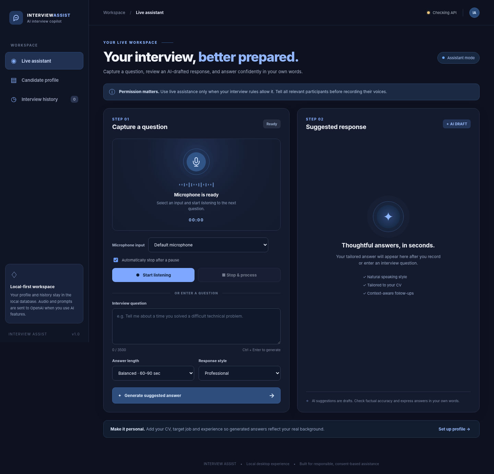

# Interview Assist — AI Interview Assistant

A local-first web app that **listens to a question through a microphone**, transcribes it through OpenAI, and displays an editable-question / read-only suggested answer tailored to your real CV, target role, and job description. The human candidate delivers the answer. Built for interview practice and interviews **where AI assistance and any recording are permitted**.



## Capabilities

- Browser-based desktop and responsive interface; no React/Node runtime required.
- Microphone selection, manual stop, and optional automatic stop after 1.65 seconds of silence.
- OpenAI speech-to-text for recorded question segments; auto-generates an answer after transcription.
- Three answer lengths and three tones. Avoids making up credentials or past achievements.
- Resume upload (PDF, DOCX, TXT, MD), job description and experience profile.
- Context-aware follow-up answers using the last four questions and suggestions.
- SQLite profile and interview history on your own computer; one-click Markdown export.
- API credentials stored **only** in a backend `.env` file, never in browser JavaScript.
- Server bound to `127.0.0.1` only. No account system or public deployment included.

## Fastest launch — Windows 10/11

1. Download/extract the ZIP to a folder such as `C:\InterviewAssist`.
2. Install **Python 3.10 or newer** from <https://www.python.org/downloads/>. On Windows check **Add python.exe to PATH** during setup.
3. Open **`launch_windows.bat`**. It creates `.venv` and a private local `.env` on first run.
4. At the **hidden-input prompt**, paste a **NEW OpenAI Platform API key** and press Enter. It is saved **only in the extracted folder's local `.env`**, never in the downloadable ZIP or frontend code. You can press Enter to skip and configure it later. Keep the terminal window open after setup.
5. Visit **http://127.0.0.1:8765** in **Google Chrome or Microsoft Edge**. Your browser will display `API configured` at the top once a key is set.
6. Click **Candidate profile** and add the target position, genuine experience, job description, and optionally upload your CV. Click **Save profile**.
7. Click **Live assistant** and select a microphone. Click **Start listening**, allow microphone access, and have the interviewer ask a question (or speak one in a mock interview). The recording stops automatically after a pause, or click **Stop & process**.
8. The transcribed question and suggested answer appear in the dashboard. Review the draft and **answer yourself**, in your own words.

**If the browser shows "Site can't be reached":** verify the Windows launcher is still open and says `Uvicorn running on http://127.0.0.1:8765` (or similar). If the port is occupied, close the other process or change the port in the command; the startup scripts use port 8765 by default.

### API key security and replacement

- **Do not reuse an API key exposed in a chat, screenshot, public repository, or shared ZIP.** Revoke the exposed key in your OpenAI Platform account and generate a replacement at <https://platform.openai.com/api-keys>.
- The Windows launcher automatically asks for a new key during the first run (hidden input). Your key is written to `.env` on **your computer only**.
- To rotate your key later, double-click **`configure_api_key_windows.bat`**, enter the new key, then restart the main launcher. On macOS/Linux, run `python3 setup_api_key.py --replace` in the project directory.
- **Never share the `.env` file.** This project excludes `.env` from Git and the distributed ZIP. The backend keeps API credentials out of browser JavaScript.

### OpenAI API account

- Create an API key at <https://platform.openai.com/api-keys>.
- Add an appropriate billing method/credits in the API Platform account if required.
- **ChatGPT Plus/Pro does not itself provide free OpenAI API credits**; API usage is billed separately. Usage costs depend on the models and amount of recorded audio/text processed.
- Default text model: `gpt-4.1-mini`; transcription: `gpt-4o-mini-transcribe`. You can change the model names in `.env` if you have access to a compatible model.
- There is no working live AI demo without an API key. The interface and local-profile features load without it.

## macOS / Linux

Run `./start_mac_linux.sh` from a Terminal within the extracted directory. If your operating system blocks script execution, run `bash start_mac_linux.sh`. Follow the `.env` steps above and open the same local address. Python venv support must be installed (on Debian/Ubuntu, `python3-venv`).

## Windows: hearing the *remote interviewer* in Zoom/Teams/Meet

**Important limitation:** browser microphone access records the **selected input device**, not every audio stream from Zoom, Teams or Google Meet. A headset microphone may not hear a remote participant playing through your headphones. This app does **not** silently connect to or monitor video-meeting software.

For authorized use, select an input which receives the interviewer's audio. Possible approaches:

1. For a simple test, play a spoken question over external speakers at moderate volume and let your laptop microphone capture it.
2. On supported Windows sound devices, enable **Stereo Mix** (Windows `Settings → System → Sound → More sound settings → Recording`; right-click and show disabled devices). Select Stereo Mix from the app's microphone dropdown after granting browser permissions. **Stereo Mix is not available on every PC**, and it often captures all system audio rather than separating the interviewer.
3. Alternatively, if your employer/meeting rules allow, install/configure a reputable **virtual audio routing device** that presents meeting sound as a Windows recording input, and select that input. This requires manual Windows sound routing, is not bundled here, and may be affected by the meeting platform's audio settings.

Close or mute unrelated applications to reduce cross-talk. The assistant cannot guarantee speaker identification. In a real interview, stop or pause capturing during your own answer, and get consent before transmitting anyone's speech to an external transcription service.

## How to operate

| Feature | How it works |
|---|---|
| Live listening | Starts recording after your click. Auto-stop tries to detect the end of a spoken question using audio level/silence. If it fails, use **Stop & process**. Maximum segment: ~55 seconds. |
| Manual input | Type or paste a question and click **Generate suggested answer**. This works without any microphone. |
| History | Stores up to the most recent 100 items for display (older records stay in SQLite until you clear history). You can export visible items as Markdown. |
| CV upload | Extracts text up to 24,000 characters. Image-only PDFs cannot be OCR'd. |
| Follow-ups | The last four locally saved answers provide context for subsequent questions. |
| Privacy | Profile and generated history are stored in `data/assistant.sqlite3`. Raw audio is held in memory and posted to the server temporarily for transcription; the app does not write recordings to disk. |

## Architecture

```
Browser (HTML, CSS, JavaScript, MediaRecorder)
       |                 |
       | /api/answer     | /api/transcribe (audio recording)
       v                 v
FastAPI on 127.0.0.1:8765 (Python backend)
       |                 |
       | Profile/history| OpenAI API (transcription and text responses)
       v                 v
 SQLite on disk      AI-generated answer
```

Folder layout:

```
ai-interview-assistant/
├── .env.example             # sample configuration, no actual secret
├── setup_api_key.py         # hidden-input, local-only credential setup
├── configure_api_key_windows.bat # change saved key securely
├── .gitignore
├── launch_windows.bat       # double-click startup
├── start_mac_linux.sh       # POSIX startup
├── requirements.txt         # runtime packages
├── requirements-dev.txt     # tests
├── README.md                # this file
├── SETUP_WINDOWS.md         # detailed setup / troubleshooting
├── server/
│   ├── __init__.py
│   ├── config.py             # env / limits / paths
│   ├── db.py                 # SQLite profile and history
│   ├── documents.py          # resume parsing
│   ├── prompts.py            # grounded answer generation prompts
│   ├── ai.py                 # OpenAI transcription and Responses API
│   └── main.py               # FastAPI routes and static files
├── web/
│   ├── index.html            # dashboard
│   ├── styles.css            # responsive design
│   ├── app.js                # browser UX / audio recording / API calls
│   └── assets/favicon.svg
├── tests/                   # offline test suite, no live API needed
└── data/                    # local SQLite DB created at runtime
```

## Developer instructions

Windows PowerShell (in the extracted project folder):

```powershell
py -3 -m venv .venv
.\.venv\Scripts\python.exe -m pip install -r requirements-dev.txt
Copy-Item .env.example .env
# Edit .env to set OPENAI_API_KEY, then:
.\.venv\Scripts\python.exe -m uvicorn server.main:app --host 127.0.0.1 --port 8765 --reload
```

Run offline tests:

```powershell
.\.venv\Scripts\python.exe -m pytest -q
```

Do not use `--host 0.0.0.0` or expose the server through a tunnel: this version deliberately has **no login, sessions or access control**. It is a single-user local app; a real public/multi-user product requires authentication, account-level data isolation, TLS, abuse throttling, a private secrets manager, and explicit privacy/retention controls. Delete `data/assistant.sqlite3` to delete all locally saved data (while the server is closed).

## Security, reliability and limitations

- User must authorize audio capture; browser prompts for permission. Data goes to the OpenAI API when you transcribe or generate answers.
- Never upload confidential employer documents or third-party audio unless permitted. Check applicable law and interview platform rules before recording.
- `.env` holds your secret API key. **Never upload/share your edited `.env` file or the local SQLite database**.
- API server restricted to localhost and allowed hostnames. No external UI dependencies or third-party analytics.
- This is not a stealth tool, an interview impersonator, or a direct meeting-platform integration. The assistant neither speaks on your behalf nor joins meetings.
- Automated silence detection is approximate; background noise, long pauses and short utterances may affect segmentation. Manually stop if needed.
- Model output can contain errors; verify claims and adapt all wording to your actual experience.
- The model receives text extracted from your uploaded profile (truncated to the documented limits) and the four latest Q&A suggestions. Profiles and history are not end-to-end encrypted at rest. Disk access to this computer is required to view them.
- API/network response latency is variable; no realtime speed is guaranteed. No audio is recorded when you have not clicked **Start listening**.

## Official references

- OpenAI Speech-to-text API: <https://platform.openai.com/docs/guides/speech-to-text>
- OpenAI Responses API: <https://platform.openai.com/docs/api-reference/responses>
- MDN MediaRecorder: <https://developer.mozilla.org/en-US/docs/Web/API/MediaRecorder>

